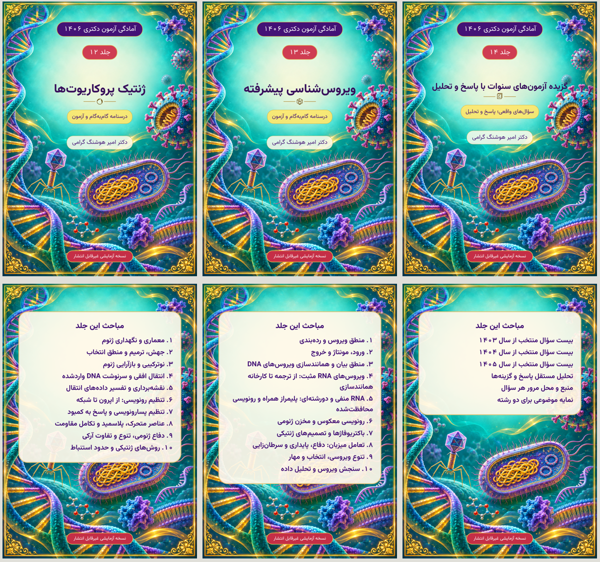

# بازطراحی وزیرمتن و صفحه‌آرایی

تاریخ: ۲۰ نوامبر ۲۰۲۶. دامنه این اصلاح، ابزار ساخت و همه خروجی‌های قابل بازتولید جلدهای ۱۲، ۱۳ و ۱۴ است. متن علمی، ترتیب سؤال‌ها و گزینه‌ها، کلیدها و فایل‌های ورودی آرشیو تغییر نکرده‌اند. گزارش‌های علمی و بصری پیشین به نسخه قدیمی و اثر انگشت همان فایل‌ها مربوط‌اند؛ این گزارش وضعیت ظاهری نسخه تازه را مشخص می‌کند.

## تغییرها

- وزیرمتن رسمی نسخه 33.003 در چهار وزن، برای متن فارسی و لاتین، اعداد، عنوان‌ها، فهرست، روی جلد، پشت جلد و هشتاد شکل به کار رفته است. اعداد و عبارت‌های لاتین دیگر با اندازه ۷۸٪ و قلم جدا نوشته نمی‌شوند.
- توان‌ها، بارها و زیرنویس‌های عددی و ژنتیکی به‌صورت واقعی در HTML، Word و شکل مربوط تولید می‌شوند. بلوک‌های محاسبات و شناسه‌های لاتین جهت مستقل دارند. حروف یونانی و پیکان‌هایی که در وزیرمتن گلیف ندارند، از قلم نماد همراه استفاده می‌کنند؛ هیچ عدد فارسی یا لاتینی به فونت جایگزین نمی‌افتد.
- روی جلد، عنوان کامل در یک خط و بدون زمینه روشن است. هر سه جلد از تصویر فیروزه‌ای، قاب طلایی و چیدمان اصلی مجموعه استفاده می‌کنند. زیر عنوان هر جلد یک نشان کوچک موضوعی آمده است. متن پشت جلد با وزن Bold و اندازه ۲۱ پوینت روی همان پنل کرم‌رنگ چاپ می‌شود. در ساخت، تک‌صفحه‌بودن جلد، جاگرفتن عنوان و بیرون‌نزدن نوشته‌ها کنترل می‌شود.
- فهرست هر سه جلد دقیقاً صفحه ۳ PDF، مستقل از مقدمه و متن فصل است. شماره مقصدها از خود PDF خوانده و با احتساب روی جلد درج شده‌اند؛ عنوان‌ها و شماره‌ها پیوند دارند. شماره پایین صفحه نیز با وزیرمتن و ارقام فارسی است.
- جدول‌های خلاصه و کلید آزمون یکپارچه می‌مانند. واژه‌نامه‌های بلند و نمایه سنوات فقط بین ردیف‌ها می‌شکنند و سرستون در صفحه بعد تکرار می‌شود. در Word نیز شکستن ردیف غیرفعال و ردیف‌های جدول کوتاه به هم متصل شده‌اند.
- فهرست Word مرز صفحه مستقل دارد و از فاصله خط ثابت استفاده می‌کند تا متریک بلند وزیرمتن باعث افزایش ناخواسته ارتفاع فهرست نشود. SVGها فونت را به‌صورت داده در خود دارند؛ تصویر شکل در HTML نیز به نصب فونت روی دستگاه خواننده وابسته نیست.

## کنترل نسخه تازه

|جلد|صفحات PDF|سؤال تطبیق‌شده در Word|فیلد تطبیق‌شده|
|---|---:|---:|---:|
|۱۲|۱۷۰|۲۷۰|۱۶۲۰|
|۱۳|۱۵۶|۲۷۰|۱۶۲۰|
|۱۴|۵۵|۶۰|۳۶۰|

- هر ۳۸۱ صفحه PDF رندر و از نظر صفحه داخلی خالی، متن خارج کاغذ و کاراکتر جایگزین کنترل شد؛ موردی گزارش نشد. هندسه هر هشتاد SVG نیز بدون بریدگی است.
- نه آزمون ابزار پاس شد؛ موارد پوشش‌داده‌شده شامل حفظ متن پس از توان‌ها، حفظ جهت محاسبات، ژنوتیپ، زیرنویس، فونت اعداد Word، مرز فهرست و قواعد جدول Word است.
- هر ۳۶۰۰ فیلدِ صورت سؤال، چهار گزینه و توضیح پاسخ در Word با منبع تطبیق داده شد. در مقایسه، تغییر نمایشی توان و زیرنویس به نویسه پایه نرمال می‌شود؛ مقدار و متن منبع عوض نشده است.
- هر ۲۸ جدول کوتاه در یک صفحه باقی مانده است. ساختار تگ‌دار PDF برای تمام ردیف‌های جدول کنترل شد و هیچ ردیف داده بین دو صفحه نشکسته است. شماره صفحه جدول‌ها در `typography-checks.json` مربوط به PDF متن، پیش از افزودن روی جلد است؛ شماره مقصدهای فهرست مربوط به PDF نهایی است.
- مقصد واقعی تمام پیوندهای داخلی، شماره‌های فهرست و تک‌صفحه‌بودن هر سه فهرست کنترل شد. فونت همه قطعات متن دارای رقم در PDF وزیرمتن است.
- هر شش جلد جلو/پشت، هر سه فهرست، نمونه‌های فرمول PFU و توان منفی، واکنش‌های دارای ΔG، شکل و نماد O با توان c، و شیت‌های نمونه صفحات بررسی بصری شدند. این بازبینی نمونه‌ای، جایگزین بازبینی علمی تازه متن نیست.

شواهد ماشینی: [کنترل خروجی و اثر انگشت فایل‌ها](output-checks.json)، [کنترل وزیرمتن، فهرست و جدول‌ها](typography-checks.json). روش تکرار در [راهنمای ساخت](../BUILD.fa.md) است.

PDF فونت‌ها را در خود دارد و مرجع صفحه‌آرایی است. برای مشاهده Word با همین قلم، وزیرمتن همراه پروژه را نصب کنید. خود Word در این محیط رندر نشده است؛ کنترل آن شامل ساختار، قواعد صفحه‌بندی، فونت‌ها و کامل‌بودن متن است.

